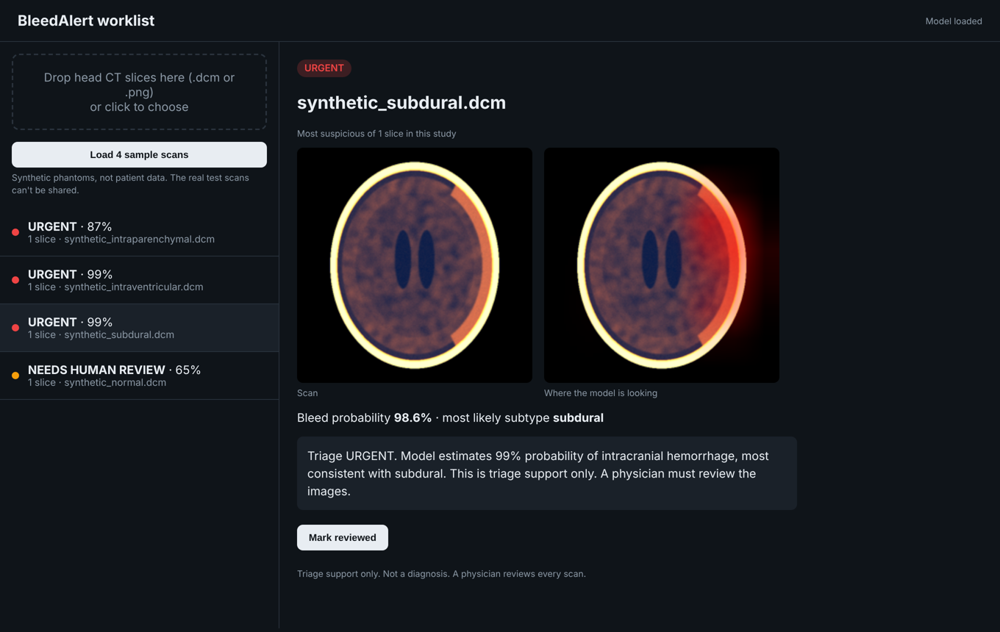

# BleedAlert

AI triage for head CT scans. BleedAlert flags slices that likely show an intracranial
hemorrhage and moves them to the top of the neurologist's worklist, so the scariest cases
get read first. It shows a heatmap of where the model is looking, writes a short case
summary with Gemini, and speaks an alert out loud.

Built at the 2026 Rutgers Health Hack (Sevaro track). **Triage support only, not a diagnosis.**

**Live demo: https://surya0901.github.io/bleedalert/** (runs entirely in your browser, scans never leave your computer)



## Results

EfficientNet-B0 fine-tuned on the [RSNA Intracranial Hemorrhage Detection](https://www.kaggle.com/competitions/rsna-intracranial-hemorrhage-detection)
dataset on free Kaggle GPUs. Tested on **17,978 slices from 2,780 patients the model never saw**
(split by patient, so no person appears in both training and testing).

| Metric | Result |
|---|---|
| AUC, any bleed | **0.978** |
| Real bleeds flagged URGENT or NEEDS HUMAN REVIEW | 95% |
| Real bleeds flagged URGENT | 90% |
| Normal slices correctly left ROUTINE | 88% |
| Slices sent to human review (model unsure) | 6% |

Subtype AUC: intraventricular 0.984, intraparenchymal 0.971, subdural 0.947, subarachnoid 0.931,
epidural 0.919. Scores are per slice on a balanced 50/50 test set, so this is not a clinical
validation. Full numbers in [`metrics.json`](metrics.json).

## How it works

```
DICOM slice ──► 3 CT windows as RGB ──► EfficientNet-B0 ──► 6 bleed probabilities
                (brain, subdural, bone)                     │
                                                            ├─► triage: URGENT / NEEDS HUMAN REVIEW / ROUTINE
                                                            ├─► Grad-CAM heatmap
                                                            ├─► Gemini case summary (template if no key)
                                                            └─► SQLite worklist, urgent first, voice alert
```

| Bleed probability | Status | What happens |
|---|---|---|
| 65% or higher | URGENT | Top of the queue, spoken alert |
| 35% to 65% | NEEDS HUMAN REVIEW | Model is unsure and says so |
| below 35% | ROUTINE | Normal order |

Slices from the same study are grouped; a study's score is its most suspicious slice.
The dashboard also includes a queueing simulation (`simulate.py`) that compares first come,
first served with BleedAlert triage. Its inputs are adjustable assumptions, not hospital data.

## Try it

The [live demo](https://surya0901.github.io/bleedalert/) runs the same model in your browser with ONNX Runtime Web. Its preprocessing is bit-for-bit identical to the Python app, and its heatmap equals Grad-CAM exactly (see `scripts/export_onnx.py`). Click **Load 4 sample scans** to try it. The RSNA license does not allow sharing
the real test scans, so the samples are **synthetic phantoms** generated by
[`scripts/make_phantoms.py`](scripts/make_phantoms.py): a skull, brain tissue, ventricles and,
in three of them, a patch of fresh blood at a realistic density. They are not patient data and
the model never saw anything like them, so they show how the app works, not how accurate it is.
On them the model flags all three bleeds as urgent (subtype right for subdural and
intraparenchymal, wrong for intraventricular) and sends the normal phantom to human review.

You can also drop in your own de-identified head CT slices (`.dcm`).

## Run it locally (free)

```bash
python -m venv venv && source venv/bin/activate      # Windows: venv\Scripts\activate
pip install torch torchvision --index-url https://download.pytorch.org/whl/cpu
pip install -r requirements.txt
uvicorn app:app --reload --port 8000
```

Open http://localhost:8000. The trained weights (`bleedalert_weights.npz`, 7 MB, half precision)
are in the repo, so the header shows **Model loaded**.

Optional Gemini summaries: get a free key at aistudio.google.com and `export GEMINI_API_KEY=...`
before starting the server.

Or with Docker: `docker build -t bleedalert . && docker run -p 7860:7860 bleedalert`.

## Train it yourself (free Kaggle GPU)

1. Verify your phone on Kaggle (needed for GPUs) and accept the RSNA competition rules.
2. Create a notebook, add the competition data, set Accelerator to GPU and Internet on.
3. Run [`train_kaggle.py`](train_kaggle.py) (or `bleedalert_train.ipynb`). It splits by patient,
   trains, prints test metrics and saves `bleedalert.pt` and `metrics.json`.
4. Put `bleedalert.pt` next to `app.py`. It takes priority over the bundled weights.

## Tests

```bash
pip install pytest httpx && pytest -q
```

The tests run the real model on the synthetic scans: health check, scoring, urgent-first
ordering, heatmaps, review flow, bad uploads and the simulation. They also run in CI.

## Project layout

```
app.py                 FastAPI: upload, worklist, review, sample scans, simulation, dashboard
model.py               model loading, prediction, Grad-CAM
ct_utils.py            DICOM to 3-window image
index.html             worklist dashboard (voice alerts via the browser's speech API)
simulate.py            queueing simulation, FIFO vs triage
train_kaggle.py        training script (patient-level split)
bleedalert_weights.npz trained weights, fp16
demo_scans/            synthetic phantom slices
scripts/make_phantoms.py
tests/
Dockerfile             container for the full app
web/                   static in-browser demo (ONNX), deployed to GitHub Pages
scripts/export_onnx.py exports web/model.onnx
```

## Data and limitations

- Trained on the RSNA Intracranial Hemorrhage Detection dataset under its competition terms.
  No scans from it are included here. The bundled weights are for research and education only.
- Per-slice evaluation on a balanced test set; real prevalence is far lower, so precision in
  practice would be lower too. No prospective or external validation has been done.
- Not a medical device. A physician must review every scan.

## License

Code: MIT. Model weights: research and educational use only (see the data terms above).
